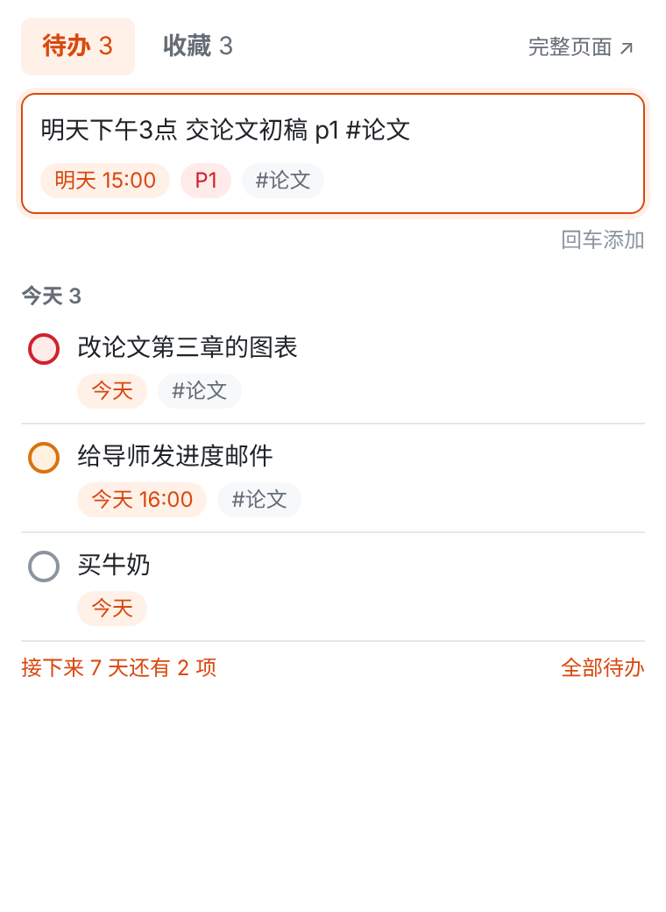
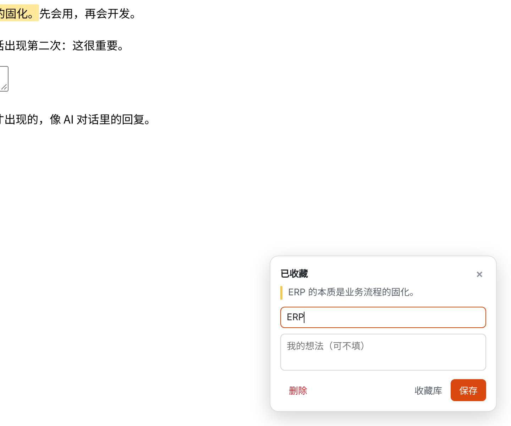
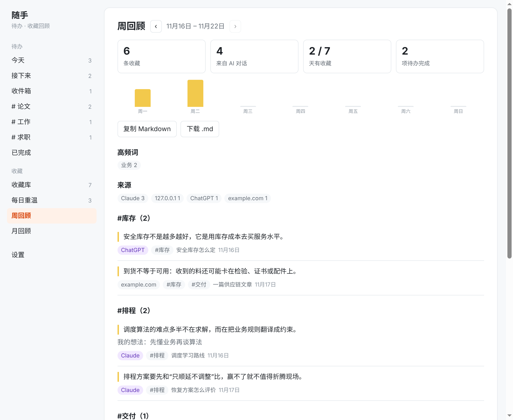

# 随手：待办与收藏回顾

一个 Chrome 扩展，做两件事：

- **待办**：一句话记一条，日期、优先级、项目、重复都从这句话里读出来。
- **收藏回顾**：上网或跟 AI 聊天时，把戳到你的那几句话随手收下来；之后每天重温几条，每周、每月自动整理成一份回顾。

数据只存在你自己的浏览器里，不联网，不需要账号。

| 一句话记待办 | 选中即收藏 |
| --- | --- |
|  |  |



## 安装

不需要构建。

1. 下载或克隆这个仓库。
2. 打开 `chrome://extensions`，打开右上角的「开发者模式」。
3. 点「加载已解压的扩展程序」，选择仓库根目录（有 `manifest.json` 的那一层）。

Edge 同理，地址是 `edge://extensions`。

## 待办

点工具栏图标或按 `Alt+T`，写一句话，回车。

| 写法 | 读成 |
| --- | --- |
| `明天下午3点 交论文初稿 p1 #论文` | 明天 15:00，最高优先级，项目「论文」 |
| `周五 交周报` | 最近的周五（今天是周五就是今天） |
| `下周三上午9点半 面试 !!` | 下周三 09:30，优先级 P2 |
| `每周五下午5点 交周报 #工作` | 每周五 17:00 重复，完成后自动生成下一条 |
| `每月5号 还信用卡` | 每月 5 号重复 |
| `2小时后 取快递` | 两小时后，到点弹通知 |
| `call dentist friday 3:30pm p2` | 英文同样可以 |

规则：

- 日期：今天、明天、后天、周几、下周几、`5月20日`、`6/18`、`20号`、月底、N 天后、N 周后。
- 时间：上午、下午、晚上加几点几分，或 `15:30`、`3pm`。只写 `3点` 按下午 3 点算。
- 优先级：`p1` 到 `p4`，或 `!!!`、`!!`、`!`。
- `#项目` 一个，`@标签` 可以多个。
- 输入时下方会实时显示读出来的结果，读错了可以直接改这句话。

工具栏图标上的数字是「已过期 + 今天」的条数。带时间的待办到点会弹系统通知。

## 收藏

在任何网页或 AI 对话页面里选中一段文字：

- 点旁边出现的「收藏」，或按 `Alt+S`，或右键选「收藏选中的文字」；
- 右下角会弹出一张小卡片，可以顺手加标签和一句自己的想法，也可以不管它；
- 「记为待办」把这段话变成一条待办，并记住来源页面。

收藏下来的句子，再次打开那个页面时会用黄色底标出来。点一下可以改标签、想法，或删除。

来自 ChatGPT、Claude、Gemini、DeepSeek、Kimi、豆包、元宝、通义、文心一言、Copilot、Perplexity、Grok、Poe 的收藏会标为「AI 对话」，其余标为网页。

## 回顾

完整页面（弹窗右上角「完整页面」）里有三种回顾：

- **每日重温**：每天拿出几条旧收藏。「还有用」的隔 3、7、14、30、90 天再出现；「没印象了」的明天再看；「已经吸收」的不再出现。
- **周回顾 / 月回顾**：这段时间收藏了多少、哪几天在收藏、来自哪里、高频词是什么；内容按标签分组；同时列出这段时间完成的待办。可以复制或下载为 Markdown。

## 隐私与权限

- 所有数据存在 `chrome.storage.local`，扩展不发任何网络请求。
- 在「设置」里可以导出一个 JSON 备份，换电脑时导入。
- 内容脚本会在所有网页上运行，用来显示「收藏」按钮和标出收藏过的句子。它不读取页面内容，只在你选中文字并点收藏时把这段文字交给扩展。不想在某些网站上出现，可以在设置里填域名。

| 权限 | 用途 |
| --- | --- |
| `storage`、`unlimitedStorage` | 保存待办和收藏 |
| `contextMenus` | 右键菜单 |
| `alarms`、`notifications` | 到点提醒 |
| `activeTab` | 「把当前页面记为待办」时读取标题和地址 |

## 开发

```bash
npm test                    # 58 个单元测试，不需要浏览器
npm run check               # 清单、文件引用、语法
python tests/e2e/run.py     # 在真实 Chrome 里加载扩展，跑 34 项检查（需要 playwright）
```

代码结构：

```text
src/core/        纯逻辑，不依赖浏览器：日期解析、快速添加、重复规则、
                 任务视图、收藏、重温调度、回顾、文本定位、存储
src/background/  后台 service worker：右键菜单、快捷键、提醒、角标
src/content/     页面里的收藏按钮、小卡片、标出收藏过的句子
src/ui/          弹窗和完整页面
tests/           单元测试和端到端脚本
```

设计说明见 [docs/design.md](docs/design.md)。

## 已知的边界

- 只支持 Chrome 和 Edge。没有手机端，也没有多设备自动同步，换设备靠导出导入。
- 收藏的是你选中的文字，不会保存整段 AI 对话。
- 端到端测试用的是仓库里的测试页面，没有逐个在各家 AI 网站上验证过；它们改版后，“再次打开时标出来”可能失效，收藏本身不受影响。
- 页面内容改动较大时，旧收藏可能找不回原来的位置，这时只是不标出来，收藏仍在库里。
- 高频词用的是浏览器自带的分词，对专业词汇会有遗漏。
- 重复规则只支持每天、工作日、每周某天、每月某号、每年，以及它们的间隔写法。

## 许可

MIT
